  

### 🧠 Sobre mim

- 🤖 Apaixonado por tecnologia, hoje focado em arquitetura de IA
- ⚙️ Construo agentes, automações e produtos que colocam IA pra trabalhar no dia a dia
- 📱 Base forte em front-end e mobile, com React e React Native
- 📚 Sempre aprendendo coisa nova

### 🔥 Stack

  
  
  
  
  
  
  
  
  
  
  
  

### 📊 Estatísticas

  
  

<picture>
  <source media="(prefers-color-scheme: dark)" srcset="./profile/snake-dark.svg" />
  
</picture>

### 🤝 Open source

### 📫 Contato

 

*"Ryuu ga waga teki wo kurau"* 
— Hanzo Shimada

 

